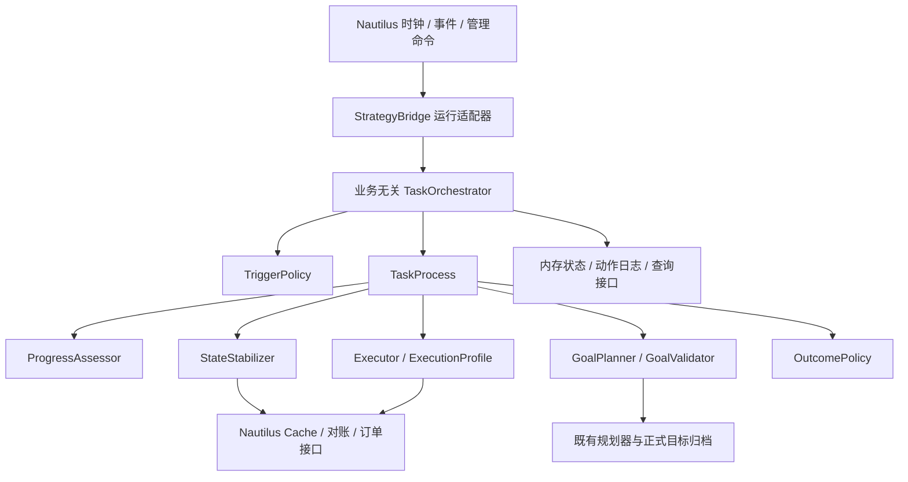
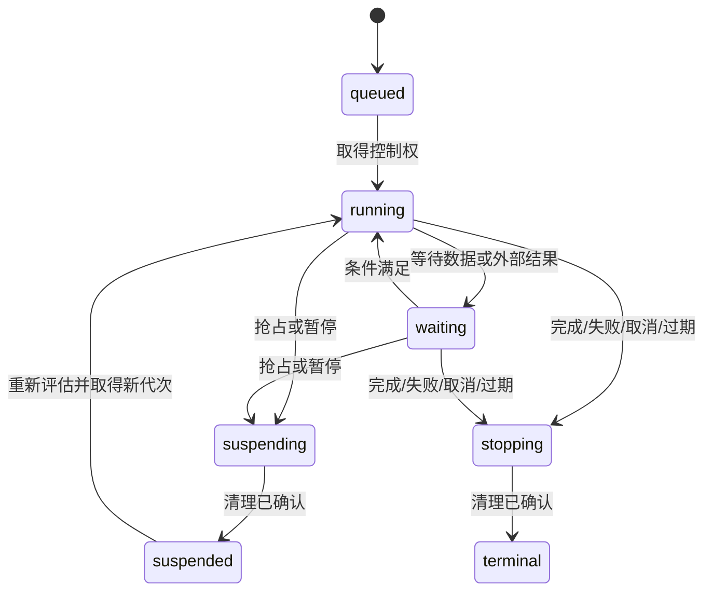

# 可回放的任务编排与目标执行设计

本文是设计文档及实现契约，不是开发排期。结合原设计评审及后续约束整理；对应实现为 `task_orchestration/` 与 `trading_orchestration/`。当前策略通过显式配置启用新编排，默认配置不启用。

## 1. 核心结论与原设计的关系

组件名称采用 **任务编排器（Task Orchestrator）**。它负责触发评估、任务准入、优先级、互斥、抢占、运行状态和动作记录。**目标规划器（Goal Planner）** 专指计算下一执行目标的组件，例如 risk manager 适配器。编排器本身不解释股票、敞口、涨跌停、订单或现金。

与原设计一致的核心理念：针对接口编程；领域插件负责业务判断；同一账户只有一个执行所有者；规划前先清理和对账；正式目标先归档再安装；利用 Nautilus 事件循环与逻辑时钟；每个决定可解释、可追踪。

吸收原设计中的任务与目标分离、静稳屏障、控制权代次、正式目标与临时目标分离、确定性输入及证据记录。后续讨论使以下内容更明确：

| 议题 | 最终选择 |
| --- | --- |
| 编排器持久化和恢复 | 运行状态只在内存，不存 checkpoint，不恢复队列、实例或阶段 |
| 启动加载 | 独立且不可抢占的 `BootstrapTask`；处理遗留订单、对账、加载当前正式目标 |
| “检测器” | 拆为触发策略与进展评估器，避免一个接口同时承担判断、规划和下单 |
| 涨跌停重规划 | 独立的目标修复任务，与正常执行共享正式目标和账户执行权 |
| 竞价后比例纠偏 | 独立高优先级任务；09:30 后先单边靠近最近容差边界 |
| 上下文 | 共享事实、执行状态、配置、不可变决策快照分开；不把全部状态复制进通用上下文 |
| 代码组织 | 每种组件一个目录，接口独立文件，每个具体实现独立文件 |
| 既有业务 | 保留当前规划约束、集合竞价、定时任务及交易算法；新增行为通过配置启用 |

盘中止损、止盈及异动卖出可以绑定为独立风险退出任务；本次保留当前已有的规划过滤规则，没有额外启用一套新的盘中触发规则。新规则的价格基准、持续条件和禁止买回期限应由相应业务插件定义。

## 2. 术语与职责

| 术语 | 含义 |
| --- | --- |
| 任务定义 `TaskSpec` | ID、优先级、启停、评估周期、抢占许可、资源范围 |
| 任务实例 `TaskRun` | 一次触发的运行记录、状态、控制权及结果 |
| 触发提议 `Proposal` | 稳定合并键、类型化业务载荷和有效期限 |
| 触发策略 `TriggerPolicy` | 回答“现在是否需要产生一个任务” |
| 进展评估器 `ProgressAssessor` | 回答“目标是否达成、是否受阻，以及依据是什么” |
| 目标规划器 `GoalPlanner` | 根据当前快照形成正式目标或临时执行目标 |
| 目标校验器 `GoalValidator` | 校验父版本、执行版本、方向、数量及约束 |
| 静稳屏障 `StateStabilizer` | 停止新增、撤单、等待终态、对账、等待迟到事件稳定 |
| 执行器 `Executor` | 安装目标、启动执行、停止新增并清理、查询目标及进展 |
| 处置策略 `OutcomePolicy` | 将业务结果映射为等待、重规划、执行或结束 |
| 任务流程 `TaskProcess` | 组合上述组件，提供非阻塞的推进与安全退出接口 |
| 执行配置 `ExecutionProfile` | 当前任务使用的拆单与撤单组件；时间窗口由任务适配器绑定 |
| 正式目标 | 已接收的 risk manager 目标版本，是后续规划和比例判断的基准 |
| 临时目标 | 只用于本轮执行，不替换正式目标和正式权重 |
| 控制权代次 `owner_epoch` | 每次交接递增，区分旧任务回调和当前执行授权 |

“任务不可达”与“组件异常”不同。约束不允许完成目标属于业务结果；接口错误、存储异常属于执行失败。缺少可信行情或账户数据属于未知，不能误报为不可达。

## 3. 架构与依赖



内核只依赖 `TaskProcess`、`TriggerPolicy` 和通用模型。任务流程通过各组件接口组织业务步骤；内核无需知道一个任务是否涉及规划。任务组合、Nautilus 类型和已有策略字段只出现在交易插件与适配层。

新增任务不修改内核状态机：实现流程及所需组件，在组合入口注册配置和工厂。组件注册表使用明确的类别和名称，不从配置任意导入 Python 模块。必需接口不通过 `getattr` 探测。

当前交易适配层仍通过 `StrategyBridge` 使用既有策略的规划、数量收敛和对账能力。它是有意保留的迁移边界，并不意味着整个旧执行器已经被拆成无状态组件。

### 3.1 文件组织

```text
task_orchestration/
  models.py
  core/orchestrator.py
  core/component_registry.py
  components/
    processes/task_process.py
    triggers/trigger_policy.py
    assessors/progress_assessor.py
    planners/goal_planner.py
    validators/goal_validator.py
    stabilizers/state_stabilizer.py
    executors/executor.py
    outcomes/outcome_policy.py
trading_orchestration/
  contexts/                 # 事实投影、执行状态及不可变快照
  configuration/            # 配置、执行组件组合
  components/
    triggers/ assessors/ planners/ validators/
    stabilizers/ executors/ outcomes/ allocations/
    splitters/              # order_splitter.py + 每种实现
    cancellations/          # cancellation_policy.py + 每种实现
  tasks/                    # 每种任务流程单独文件
  adapters/                 # Nautilus、正式目标归档、旧策略适配
```

`target_quantities.py` 仅接入原有状态字段的统一所有者和执行报价窗口接口。新编排、纠偏公式、组件配置及任务状态不放入该文件。

## 4. 上下文设计

### 4.1 分离不同生命周期

| 层次 | 内容 | 写入者与生命周期 |
| --- | --- | --- |
| 共享市场事实 `MarketState` | 最新行情、全市场行情、盘口、开盘价、前收盘 | 当前策略的行情回调；按既有生命周期更新 |
| 真实账户与订单事实 | 持仓、可卖、现金、活动/在途订单、成交 | Nautilus Cache、Portfolio 与现有对账基础设施 |
| 执行状态 `ExecutionState` | 当前数量目标、冻结标的、延迟买入、资金不足、待重报、订单报价状态 | 当前执行器；保留原有重置规则 |
| 正式规划状态 `TradingState` | 规划版本映射与当前正式模型 | 规划结果接收适配器 |
| 任务运行状态 | 队列、控制权、阶段、锁存、命令结果 | 编排器和任务流程，内存有效 |
| 配置 | 时间窗口、阈值、费用、组件名称 | 启动加载，严格校验 |
| 决策快照 `ExposureContext` 等 | 本次判断用到的不可变事实、版本与数据质量 | 在所有者循环一次捕获，组件只读 |

旧字段通过 `TargetStateOwner` 显式属性指向同一份状态，避免新旧两份字典漂移。订单事实不再复制维护另一份 order book。新增任务自己的状态放在自己的结构体中，不扩张通用编排上下文。

### 4.2 通用上下文与领域快照

`TaskContext` 只包含逻辑时间、事件序号、实例 ID、控制权代次及触发提议。`Proposal.payload` 由对应插件定义类型，内核不读取业务字段。

纠偏快照包括：交易日、执行版本、正式目标版本与权重、固定缓冲金额、总资产、可用现金、全体相关股票的实际数量/实时估值/可卖数量/买卖许可/数量规则/执行报价、未决订单数量及剩余方向数量、数据质量原因。映射在快照构造时复制并只读封装。

可变实时状态、锁、Cache、网络客户端、线程池不进入决策 DTO。跨线程查询返回已发布快照，不在 HTTP 查询线程现场读取交易状态。

## 5. 任务目录和调度规则

### 5.1 默认绑定

数字越大优先级越高。下表是当前配置默认值。

| 任务 | 优先级 | 触发/窗口 | 目标处理 |
| --- | ---: | --- | --- |
| `bootstrap` | 1000 | 每次进程启动，普通任务前置门禁 | 加载当日有效正式快照，不恢复旧实例 |
| `manual_replan` | 500 | 当前手动重规划入口与原有窗口 | 重新规划并归档正式目标 |
| `manual_execution` | 500 | 当前手动卖出入口 | 使用人工目标，保留手动触发对交易暂停的授权 |
| `exposure_correction` | 300 | 09:30–11:30、13:00–14:56，每秒评估 | 先局部单边纠偏，必要时请求正式重规划 |
| `price_limit_replan` | 200 | 原涨跌停触发策略和有效窗口 | 修复正式目标 |
| `scheduled_replan` | 200 | 原配置中的定时重规划事件 | 重新规划正式目标 |
| `daily_planning` | 100 | 原每日目标生成入口 | 复用当日正式目标或生成目标 |
| `auction_planning` | 100 | 原集合竞价冻结目标事件 | 使用竞价规划快照 |
| `auction_execution` | 100 | 原集合竞价提交窗口 | 保留竞价算法、预算和排名 |
| `normal_execution` | 100 | 原普通执行窗口，当前约 14:30 起 | 执行最新有效数量目标 |

风险退出任务建议优先级 400，但它不在当前默认启用目录中；相应新业务规则尚未绑定。

### 5.2 仲裁

同一账户使用同一资源范围，最多一个活动所有者。不同实例不能同时修改目标或下单。当前适配默认整个策略账户是一个范围；本内核不提供跨进程账户锁，部署侧须保证该账户只有一个编排所有者。

一次 tick 先评估所有到期的触发策略，再按优先级降序、入队序号、任务 ID 选择。相同优先级不抢占。周期依据上次到期时间推进；长时间跳跃后只评估当前事实，不补发大量历史触发。

每个任务定义最多一个未终结实例，重复触发合并；已冻结的规划请求不被原地改写。任务重新取得控制权时重建流程，从最新正式目标和实际状态重新评估，不续用旧订单队列。

有效期到达后排队任务直接过期；已持有执行权的任务先进入清理，确认结束后才释放资源。执行窗口、撤单窗口分别检查，优先级不能扩大交易所权限。

### 5.3 抢占和覆盖

抢占需要高优先级任务 `can_preempt=true`，且当前任务 `preemptible=true`。流程为：

```text
停止旧任务新增动作
→ 请求撤单并等待确认
→ 对账，等待迟到成交/撤单事件稳定
→ 释放旧控制权，增加 owner_epoch
→ 新任务重新评估、规划和执行
```

抢占不等于自动覆盖正式目标。正式规划通过校验和归档后才替换正式版本；临时纠偏只替换当前执行数量。人工卖出目标保持原有保护，自动规划和纠偏不能将其恢复成旧模型目标；有冲突的手动操作返回明确忙状态。

### 5.4 开启、停用、暂停

- 启用：恢复触发评估，使用当前事实。
- 停用定义：拒绝新触发，取消排队/挂起实例；当前所有者默认完成本次任务。需要立即结束时显式取消实例。
- 取消实例：活动任务先清理再终结，不能直接丢弃执行责任。
- 暂停编排：停止新准入，活动任务清理后挂起；恢复后重建流程。
- 进程停止：撤销新工作，尝试清理并记录最终状态。Nautilus 停止回调不能等待无限期交易所回报，未完成清理由下次启动对账处理，不保存运行 checkpoint。

原有“暂停交易”和“暂停目标更新”控制仍保留，与编排暂停分别展示。开启/停用和命令结果仅在本进程有效。

## 6. 状态与结果

编排生命周期为 `initializing → ready → stopping → stopped`。初始化期间只允许启动任务运行。

任务实例状态：



终态包括 `succeeded`、`failed`、`unachievable`、`cancelled`、`expired`。排队或挂起且没有未决副作用的实例可以直接进入终态。清理异常不会自动释放所有权。

对外业务目标状态为未开始、进行中、已完成、当前不可达，并附阻塞原因。任务执行成功不一定表示全部调仓完成：纠偏只保证持仓比例进入容差；正式目标是否完成还要检查逐股实际数量和未决订单。当前 `_target_achieved()` 会跳过冻结股票，不能直接充当这一业务判断。

`Decision` 返回运行状态、稳定原因码、证据映射。进展评估区分达标、需要纠偏、等待结算和数据未知；容量不足通过处置策略请求 risk manager，不能靠“冻结后跳过”宣布目标完成。

实例首次确定终态结果时，保存完整 `Decision`（状态、原因、证据的独立快照），之后的清理不覆盖这一结果。业务已完成但清理未确认时，实例仍为 `stopping` 并持有执行权；后到的期限、取消或停止请求不把已确定的业务结果改写成其他终态。尚无业务终态时，这些控制操作分别记录 `proposal_expired`、`cancelled`、`shutdown`。清理异常继续保留执行责任。

## 7. 接口契约与执行配置

| 接口 | 当前方法 | 约束 |
| --- | --- | --- |
| `TriggerPolicy` | `evaluate(now_ns) -> Proposal | None` | 不下单，不调用优化器 |
| `TaskProcess` | `advance(context)`、`quiesce(context)` | 一次推进有限步骤；清理成功才允许交接 |
| `ProgressAssessor` | `assess(snapshot)` | 读取同一次决策快照，输出状态及证据 |
| `GoalPlanner` | `plan(context)` | 领域特定类型；可计算目标或轮询独立工作结果 |
| `GoalValidator` | `validate(snapshot, goal)` | 安装前复核版本、方向和合法范围 |
| `StateStabilizer` | `stabilize(context)` | 非阻塞推进，未知状态不能报告成功 |
| `Executor` | `apply`、`start`、`hold`、`snapshot` | 安装与启动分开；状态含目标、剩余量和未决动作 |
| `OutcomePolicy` | `decide(result)` | 只选择后续处置，由流程执行 |
| `OrderSplitter` | `split(instrument, quantity, price, allow_odd_lot)` | 不扩大目标，不越过每笔数量与金额限制 |
| `CancellationPolicy` | `reconcile(trading_date)` | 复用原撤单判定；交易动作仍受当前执行授权约束 |

组件使用结构化 Protocol；不强制具体实现继承一个共同业务基类。泛型接口中的输入和结果类型由任务组合确定。

现有普通执行器通过适配层复用。`ExecutionProfile` 为每个任务绑定独立的拆单、撤单组件；操作期间安装所选组件，结束后恢复，交接前必须清理。当前默认 `existing_notional` 和 `existing` 分别适配现有金额拆单和现有撤单流程。集合竞价专用拆单与预算仍由既有竞价执行路径负责。

报价窗口读取当前执行配置：纠偏使用上午/下午连续交易窗口，普通任务继续使用原 14:30 配置。撤单许可始终沿用独立的当前撤单窗口。新执行算法通过新实现和显式组合接入，不把任务类型分支加到数量收敛主体中。

## 8. 静稳屏障与正式规划

静稳条件包括：不存在当前策略的活动/在途/待撤订单，原有规划协调器不忙，对账完成，执行事件版本在静稳等待期间不再变化。发现账户其他策略的未决订单时等待，不越权替它撤单。

撤单仅使用 Nautilus 接口。撤单请求成功不等于订单终结；不可撤时段、迟到成交、对账未完成、清理异常都保留旧所有者。等待期间回报正常更新真实状态，但旧目标不产生新委托。

静稳组件在所有者循环中消费异步对账结果，成功、失败或取消的 Future 都只消费一次。超时、连接失败、对账服务返回失败和 Future 取消属于可重试等待，不把启动任务判成最终失败；编程或契约错误仍向上报告。重试使用调度上下文的逻辑时间，默认间隔 5 秒，并记录错误类型、尝试次数与下次重试时间。

每个订单分别记录撤单请求次数和时间。Nautilus 状态退出 pending cancel 且重试间隔已到时，允许再次请求；同一轮最多 3 次。连续拒绝耗尽次数或确认超过 30 秒时，即使订单仍活动也先请求 Nautilus 对账。成功对账后重新读取订单状态，再按间隔开始新一轮；pending cancel 未解除时不重复撤单。对账不受撤单窗口限制，撤单始终受限。未配置对账服务且重试耗尽时，显式等待 `cancellation_requires_reconciliation`，不能假定清理成功；后续真实终结回报仍可解除等待。这些限制可通过静稳组件构造参数设置。

正式规划步骤：

1. 静稳后记录交易日、当前正式父版本、执行版本和控制权代次。
2. 复用当前策略的输入构造与约束过滤，冻结请求 DTO。
3. 实盘把优化器调用放到工作线程；完成后只在所有者循环消费结果。
4. 校验超时、日期、父版本、执行版本及未决订单；无效或迟到结果不安装。
5. 复用已有结果验证及规划归档，正式候选归档成功后再安装。
6. 安装时暂停自动收敛；由获准的执行任务启动交易。

存储错误不接收新候选，保留原正式目标。保留已有 `_local_safety_plan` 的语义，不额外引入新的自动兜底策略；其非持久化安全结果要与成功正式提交区别记录。

当前正式归档沿用原同步事务接口，因此数据库响应时间可能延迟所有者循环；此接口保证提交顺序，但不承诺非阻塞存储延迟。优化器 I/O 已独立，领域逻辑不直接访问数据库或券商。

## 9. 启动任务：不恢复编排器

每次启动创建空内核和新实例序号：

```text
INITIALIZING
→ 禁止普通任务新增交易
→ 清理遗留订单、对账并等待稳定
→ 加载 risk manager 当前有效正式目标快照
→ 安装正式数量、权重与规划资产基准
→ READY
→ 各任务按当前时间和事实重新触发
```

有效空目标（清仓）与没有目标快照不同。无当日快照可以进入 ready，由日常规划入口产生目标；快照损坏或读取失败留在初始化等待并记录原因，不能伪装成空目标。

bootstrap 成功仅在调度器仍为 `initializing` 时切换到 `ready`。成功已确定但清理尚未结束时收到停止请求，保留成功原因与证据，清理完成后进入 `stopped`，不得重新接受任务。

快照记录组件不再绕过编排器自行规划/接收目标。启动前到达的任务请求先缓存在适配层，启动门禁建立后才进入队列。

只持久化业务事实：正式规划快照、其输入和结果、实际订单成交。任务动作可通过既有日志系统归档调查，不能作为重启恢复指令。14:35 重启后可重新创建普通执行实例，但不会恢复 14:30 的旧任务、重发旧委托或沿用旧现金预算。

## 10. 竞价后持仓比例纠偏

### 10.1 目标与口径

竞价买卖成交不对称后，如果实际持仓比例偏离目标超过 **5 个百分点**，优先单边降低偏差。盘中外部入出金归因不在本次范围；交易费用、冻结和实际现金仍按现有账户规则处理。

```text
A(t) = 当前总资产
B(v) = 当前正式目标规划时固定预留的缓冲金额
D(t) = A(t) - B(v)
M(t) = 全部实际持仓的实时市值
R(t) = M(t) / D(t)
R*(v) = 当前正式目标的权重之和
E(t) = R(t) - R*(v)
```

规划时资产 100 万、预留缓冲 12 万；实时资产为 102 万时分母为 90 万。缓冲金额不按实时资产重新乘比例；正式重规划后使用新版本的缓冲金额。

权重和分母须采用同一基准。既有特殊账户如果使用不同规划资产基数，正式目标适配器显式换算权重。缺权重、无可信价格/总资产、分母不为正时返回未知并等待。

- `E > 0.05`：只卖出，减少超配。
- `E < -0.05`：只买入，补足欠配。
- `abs(E) <= 0.05`：比例达标；若存在未决订单，先清理后确认。

这是绝对比例差，不是“相对目标差 5%”。全部实际持仓进入分子，不只统计计划中的股票。

### 10.2 局部纠偏规划

优先使用当前正式计划尚未完成的同方向数量，不突破单股正式剩余需求。正式数量与实际数量间的差额不足、涨跌停、停牌、可卖约束、现金、手续费及整手限制都参与判断。

按既有预测排名及稳定股票 ID 排序；卖出优先较弱标的，买入优先较强标的。部分股票不能交易时，使用其他仍有合法同方向余量的股票。

忽略随后的价格与费用变化时：

```text
超配需卖金额 = M - (R* + 0.05) × D
欠配需买金额 = (R* - 0.05) × D - M
```

只需到最近容差边界。整手进位不能越出另一侧容差。临时目标保留其他股票的实际数量，使执行器只产生本轮纠偏方向的需求；比例评估始终引用正式权重，不随临时目标漂移。

规划与逐笔订单准入共用数量选择规则。买入数量同时满足交易单位、最小数量和连续交易最低金额；沿用现有执行器的严格“大于最低金额”语义。到最近边界的订单过小时，可在另一侧容差、正式剩余目标和可用现金（含费用）允许的范围内增大数量。金额门槛使用可执行委托价格，仓位偏差仍使用快照估值价格。

快照保留标的的 `allow_odd_lot_sell`。正式目标为零且剩余未委托持仓全部可卖时，允许一次清理零股余量；普通部分卖出仍按交易单位和最小数量约束。逐笔准入同时计入在途卖单；快照的可卖数量已经扣除这些订单，不能重复扣减。合法零股清仓仍不得越过容差上界或物理子单申请数量。

当前局部分配采用确定性排名贪心算法，遵守数量和预算约束，不作为所有整数分配组合不可行的数学证明。无法形成合规本地方案时交给 risk manager；实际下单继续经过原拆单和现金门控。

### 10.3 在途订单与重新评估

每笔物理子单提交前，重新捕获状态并计算：实际偏差、同方向在途剩余数量及预计金额、单股正式剩余需求、另一侧容差边界。未决订单已经覆盖需求时，不再追加订单；有相反方向未决订单时先清理。

成交后按新数量和实时价格重评估；达标、方向反转、正式版本改变时停止原临时计划，清理并恢复当前正式目标。不能把未成交卖单的预计收入当成可用现金。

### 10.4 无法在本地完成的后续

全部相关股票不可交易、剩余同方向容量不足，或本地数量/现金约束不能组成合法计划时：

```text
停止新增 → 静稳 → 当前事实快照 → risk manager
→ 校验并归档新正式目标 → 更新基准 → 重新评估比例
```

触发与结果记录所需金额、可用容量、逐股排除原因和父版本。相同约束状态锁存，避免每秒请求服务；自身刚收到的重规划结果不会立即引发同一状态的无限循环。持仓、可卖、交易许可或外部正式目标变化后再评估；即使锁存，行情变化后形成可行本地方案仍可继续执行。

## 11. 集合竞价和普通任务衔接

集合竞价分为规划冻结和执行两类任务，分别保留原始时点、快照和报价更新规则。高优先级任务不能在不可撤时段强行接管订单。

09:30 连续交易开始后，先处理竞价遗留订单并对账，再判断是否需要纠偏。纠偏结束后恢复正式目标；普通任务只在其原有执行窗口内继续完成剩余数量。

“买卖等量”必须声明是股数、市值、委托金额还是成交金额。本次新增纠偏解决的是持仓比例偏差，不把它解释成买卖股数相等，也没有新增另一套集合竞价委托金额配平算法。现有竞价固定预算、手续费、排名及专用拆单规则保持原义。

## 12. 线程安全与回测确定性

内核用串行锁和重入事件队列保证一次只推进一个状态转换。实盘 timer 回调通过已有异步调度器投递到 Nautilus 所有者循环，管理命令排队处理；交易动作经过既有交易锁及当前执行授权。优化器工作线程只接收独立请求，不写 Cache 或策略。

回测使用 Nautilus 逻辑时钟。无运行事件循环时同步消费规划结果，真实优化器耗时不推进模拟时间；事件排序、优先级、入队顺序、候选排序与实例 ID 均确定。固定行情、初始账户、配置、约束、优化器响应、费用及撮合输入后，重复运行应产生相同决策和订单。

外部 risk manager 自身若依赖变化数据、随机种子、多线程求解或时限截断，编排器不能保证其输出相同。严格复现需要冻结或回放归档的优化器结果。本次重复回放测试使用固定规划响应和真实 Nautilus 撮合；日线回测不能证明全部盘中事件顺序。

## 13. 可观测与管理

每个调度动作记录递增序号、逻辑时间、任务/实例 ID、动作、原因和证据。记录覆盖排队、合并、准入、进展、请求清理、挂起、等待清理、终结及组件异常；统计按动作累计。领域纠偏证据包括比例、分子分母、方向、数量、容量和排除原因。

终结过程分别记录 `OUTCOME_DECIDED`（业务或控制结果已确定）、`WAITING_CLEANUP`（清理尚未确认）、`CLEANUP_COMPLETED`（清理成功）和 `TERMINATED`（释放责任后的最终结果）。`TERMINATED` 保留已确定的业务原因及证据，不能用清理原因 `execution_stable` 替代。清理状态或证据变化时记录新动作，相同结果不重复刷日志；审计证据复制为独立快照，后续组件修改不会改写历史记录。

实例查询中的 `final_result` 包含已确定的终态 `state`、`reason`、`evidence`；`cleanup_result` 单独包含最近的清理结果，两者未产生时为 `null`。等待清理期间，实例顶层 `state/reason` 描述当前清理阶段；终结后顶层原因恢复为业务终态原因。快照与动作查询返回独立的证据副本，供外部展示和排查使用。

记录保存在内存，并通过策略结构化日志输出。审计输出失败增加 `AUDIT_ERROR`，不自行引入一条新的交易停机规则。当前没有编排器数据库表，也没有日志驱动恢复。

| 接口 | 用途 |
| --- | --- |
| `GET /scheduler/state` | 已发布运行快照：任务开关/优先级、实例状态、所有者、统计、纠偏判断及执行目标进展 |
| `GET /scheduler/actions?after_sequence=0&limit=100` | 动作与上下文查询，每次最多 1000 条 |
| `GET /scheduler/commands` | 管理命令接受/应用/拒绝结果 |
| `POST /scheduler/control` | 沿用既有控制 token 鉴权，返回 202 与命令 ID |

命令格式：

```json
{"action": "enable", "arguments": {"task_id": "exposure_correction", "enabled": false}}
```

其他命令：`cancel`（`run_id`）、`pause`、`resume`、`reevaluate`。后三者参数为空对象。HTTP 接受不代表命令已应用，查询命令结果确认。修改任务优先级及组件组合目前通过配置重启生效，不提供未经校验的在线替换。

内存日志和终态实例当前保留到进程退出；查询分页限制响应大小，不等于自动内存淘汰。长时间连续运行需要按日志留存要求配置外围归档，后续内存裁剪不能丢弃活动实例和未决订单责任。

## 14. 配置方式

原策略 YAML 显式添加：

```yaml
task_orchestration_config: configs/task_orchestration.yaml
```

路径相对于进程工作目录。实盘和回测共用该入口；省略或留空继续现有流程。编排配置示例：

```yaml
schema_version: 1
poll_interval_secs: 0.5
exposure_components:
  assessor: position_ratio
  planner: remaining_target
  validator: formal_remainder
  executor: nautilus_exposure
  stabilizer: cancel_reconcile
  risk_planner: risk_manager
  outcome: capacity_replan
exposure:
  enabled: true
  tolerance: "0.05"
  windows: "09:30-11:30,13:00-14:56"
  interval_secs: 1.0
  priority: 300
  commission_rate: "0.000085"
  minimum_fee: "5"
  quote_max_age_secs: 4.0
tasks:
  normal_execution:
    priority: 100
    can_preempt: true
    preemptible: true
    splitter: existing_notional
    cancellation: existing
  exposure_correction:
    priority: 300
    enabled: true
```

任务未列出时使用第 5 节默认绑定。`tasks.exposure_correction.enabled` 是最终定义开关，省略时继承 `exposure.enabled`。未知键、未知任务、未知组件、无效布尔值/周期/窗口在加载或装配时失败。当前纠偏业务组件组集中配置，拆单/撤单组件可按任务选择。

## 15. 验证契约与实现边界

验证包括：安全抢占和清理失败保留责任、同优先级顺序、暂停/取消/期限、重入串行、启动门禁与全新实例、精确 5 个百分点、固定缓冲基准、单边与最近边界、部分/全部受限、容量/现金不足、未知数据、不可变映射、在途承诺及逐笔限量、正式归档先于安装、存储失败、过期规划结果和真实上午回放。

回放覆盖纠偏启用/停用、上午买入补足、完成判定及同输入重复决策/订单一致，并与现有竞价、重规划和执行器测试一起回归。外部 risk manager、数据库和真实交易所均由测试边界替身替代，不据此声称已完成实盘验证。

尚未新增的业务行为包括独立盘中风险退出规则、新集合竞价配平算法、外部入出金归因和跨进程账户协调。现有组件的同步归档延迟、局部贪心分配以及内存历史保留边界见前文；这些边界不能被“业务无关”或“可回测”这一名称隐去。

### 15.1 本次验证记录

2026-11-20，本地 Python 3.12 / Nautilus 环境，固定 uvloop 策略，禁用 pytest 自动插件加载：

| 验证 | 结果 |
| --- | --- |
| 修改前全量基线 | 672 通过、30 失败 |
| 全量回归 | 707 通过、30 失败；失败 testcase ID 集合与基线完全一致 |
| 最后启动边界补充后的定向回归 | 105 通过、0 失败；包含内核、规划、Nautilus 回放、原竞价及重规划测试 |
| 语法编译、配置加载、包发现、`git diff --check` | 通过 |

最后补充的启动回放验证了有效空目标不调用优化器、损坏正式快照不放行普通任务，以及竞价回调不能绕过启动任务加载归档。全量结果与最后定向结果分别列出，不将未运行的测试数量合并为一次全量结果。
