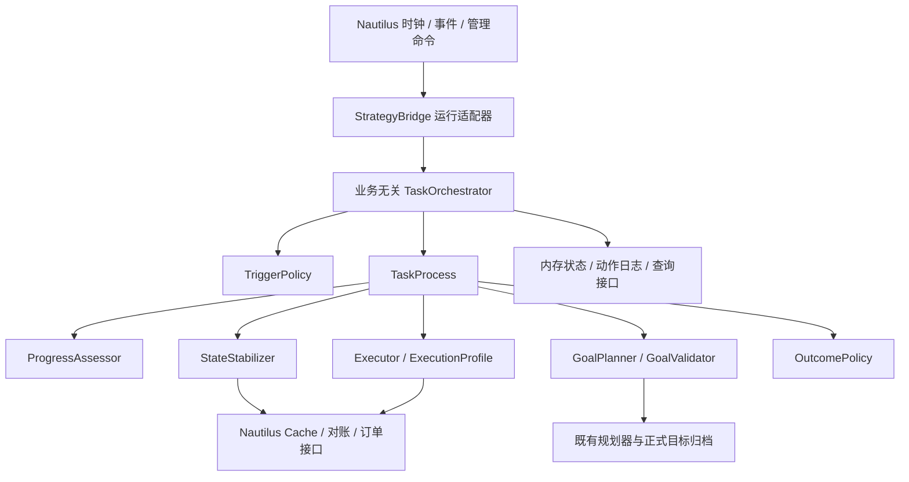
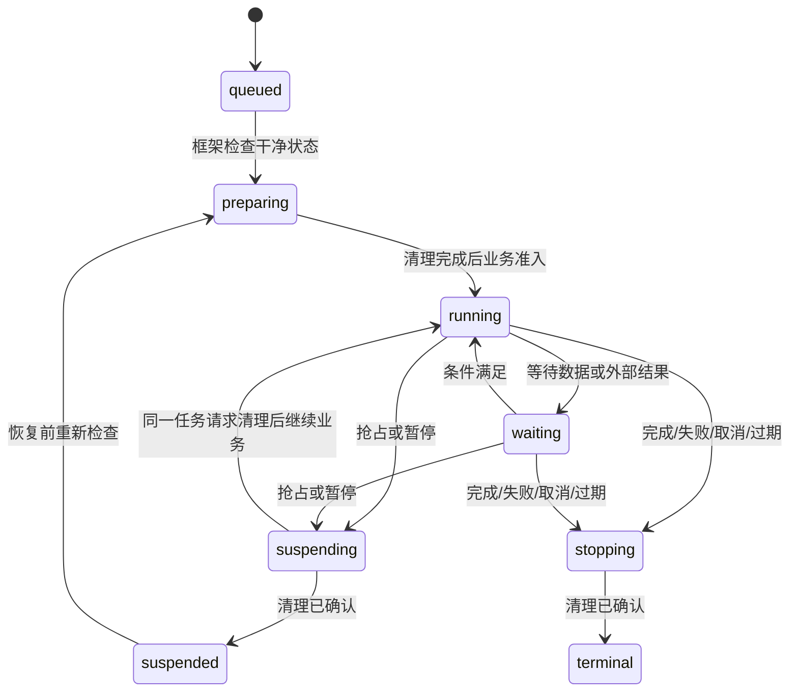

# 可回放的任务编排与目标执行设计

本文是设计文档及实现契约，不是开发排期。结合原设计评审及后续约束整理；对应实现为 `task_orchestration/` 与 `trading_orchestration/`。模型策略必须通过编排器运行，没有旧调度路径或全局停用开关；各任务仍可单独配置启停。

## 1. 核心结论与原设计的关系

组件名称采用 **任务编排器（Task Orchestrator）**。它负责触发评估、任务准入、优先级、互斥、抢占、运行状态和动作记录。**目标规划器（Goal Planner）** 专指计算下一执行目标的组件，例如 risk manager 适配器。编排器本身不解释股票、敞口、涨跌停、订单或现金。

与原设计一致的核心理念：针对接口编程；领域插件负责业务判断；同一账户只有一个执行所有者；框架在任务准入与切换时统一清理和对账；正式目标先归档再安装；利用 Nautilus 事件循环与逻辑时钟；每个决定可解释、可追踪。

吸收原设计中的任务与目标分离、静稳屏障、控制权代次、正式目标与临时目标分离、确定性输入及证据记录。后续讨论使以下内容更明确：

| 议题 | 最终选择 |
| --- | --- |
| 编排器持久化和恢复 | 运行状态只在内存，不存 checkpoint，不恢复队列、实例或阶段 |
| 启动加载 | 框架先处理遗留订单并对账；不可抢占的 `BootstrapTask` 只加载当前正式目标 |
| “检测器” | 拆为触发策略与进展评估器，避免一个接口同时承担判断、规划和下单 |
| 涨跌停重规划 | 独立的目标修复任务，与正常执行共享正式目标和账户执行权 |
| 竞价后比例纠偏 | 独立高优先级任务；09:30 后先单边靠近最近容差边界 |
| 上下文 | 共享事实、执行状态、配置、不可变决策快照分开；不把全部状态复制进通用上下文 |
| 代码组织 | 每种组件一个目录，接口独立文件，每个具体实现独立文件 |
| 既有业务 | 保留规划约束和交易算法；统一按编排周期推进，任务切换立即按撤单窗口清理，不保证与旧路径成交时机相同 |
| 切换约束 | 不存在活动、在途提交或待撤订单时才能启动下一任务；不可撤时停止新增并等待，不跨任务承接订单 |

盘中止损、止盈及异动卖出可以绑定为独立风险退出任务；本次保留当前已有的规划过滤规则，没有额外启用一套新的盘中触发规则。新规则的价格基准、持续条件和禁止买回期限应由相应业务插件定义。

## 2. 术语与职责

| 术语 | 含义 |
| --- | --- |
| 任务定义 `TaskSpec` | ID、优先级、启停、评估周期、抢占许可、资源范围、入场及正常成功退出清理策略 |
| 任务实例 `TaskRun` | 一次触发的运行记录、状态、控制权及结果 |
| 触发提议 `Proposal` | 稳定合并键、类型化业务载荷和有效期限 |
| 触发策略 `TriggerPolicy` | 回答“现在是否需要产生一个任务” |
| 进展评估器 `ProgressAssessor` | 回答“目标是否达成、是否受阻，以及依据是什么” |
| 目标规划器 `GoalPlanner` | 根据当前快照形成正式目标或临时执行目标 |
| 目标校验器 `GoalValidator` | 校验父版本、执行版本、方向、数量及约束 |
| 静稳屏障 `StateStabilizer` | 由框架独占调用；撤单、等待终态、对账、等待迟到事件稳定 |
| 执行器 `Executor` | 安装目标、启动执行、稳定后释放临时目标、查询目标及进展 |
| 处置策略 `OutcomePolicy` | 将业务结果映射为等待、重规划、执行或结束 |
| 任务流程 `TaskProcess` | 组合业务组件，提供推进、中断业务工作和稳定后释放业务状态的接口 |
| 执行配置 `ExecutionProfile` | 当前任务使用的拆单与撤单组件；时间窗口由任务适配器绑定 |
| 正式目标 | 已接收的 risk manager 目标版本，是后续规划和比例判断的基准 |
| 临时目标 | 只用于本轮执行，不替换正式目标和正式权重 |
| 控制权代次 `owner_epoch` | 每次交接递增，区分旧任务回调和当前执行授权 |

“任务不可达”与“组件异常”不同。约束不允许完成目标属于业务结果；接口错误、存储异常属于执行失败。缺少可信行情或账户数据属于未知，不能误报为不可达。

## 3. 架构与依赖



内核只依赖 `TaskProcess`、`TriggerPolicy` 和通用模型。任务流程通过各组件接口组织业务步骤；内核无需知道一个任务是否涉及规划。任务组合、Nautilus 类型和已有策略字段只出现在交易插件与适配层。

新增任务不修改内核状态机：实现流程及所需组件，在组合入口注册配置和工厂。组件注册表使用明确的类别和名称，不从配置任意导入 Python 模块。必需接口不通过 `getattr` 探测。

当前交易适配层仍通过 `StrategyBridge` 使用既有策略的规划、数量收敛和对账能力。它是有意保留的迁移边界，并不意味着整个旧执行器已经被拆成无状态组件。

### 3.1 文件组织

```text
task_orchestration/
  models.py
  core/orchestrator.py
  core/component_registry.py
  components/
    processes/task_process.py
    triggers/trigger_policy.py
    assessors/progress_assessor.py
    planners/goal_planner.py
    validators/goal_validator.py
    stabilizers/state_stabilizer.py
    executors/executor.py
    outcomes/outcome_policy.py
trading_orchestration/
  contexts/                 # 事实投影、执行状态及不可变快照
  configuration/            # 配置、执行组件组合
  components/
    triggers/ assessors/ planners/ validators/
    stabilizers/ executors/ outcomes/ allocations/
    splitters/              # order_splitter.py + 每种实现
    cancellations/          # cancellation_policy.py + 每种实现
  tasks/                    # 每种任务流程单独文件
  adapters/                 # Nautilus、正式目标归档、旧策略适配
```

`target_quantities.py` 仅接入原有状态字段的统一所有者和执行报价窗口接口。新编排、纠偏公式、组件配置及任务状态不放入该文件。

## 4. 上下文设计

### 4.1 分离不同生命周期

| 层次 | 内容 | 写入者与生命周期 |
| --- | --- | --- |
| 共享市场事实 `MarketState` | 最新行情、全市场行情、盘口、开盘价、前收盘 | 当前策略的行情回调；按既有生命周期更新 |
| 真实账户与订单事实 | 持仓、可卖、现金、活动/在途订单、成交 | Nautilus Cache、Portfolio 与现有对账基础设施 |
| 执行状态 `ExecutionState` | 当前数量目标、冻结标的、延迟买入、资金不足、待重报、订单报价状态 | 当前执行器；清理组件撤销旧任务的延迟买入和待重报意图，其余保留原重置规则 |
| 正式规划状态 `TradingState` | 规划版本映射与当前正式模型 | 规划结果接收适配器 |
| 任务运行状态 | 队列、控制权、阶段、锁存、命令结果 | 编排器和任务流程，内存有效 |
| 配置 | 时间窗口、阈值、费用、组件名称 | 启动加载，严格校验 |
| 决策快照 `ExposureContext` 等 | 本次判断用到的不可变事实、版本与数据质量 | 在所有者循环一次捕获，组件只读 |

旧字段通过 `TargetStateOwner` 显式属性指向同一份状态，避免新旧两份字典漂移。订单事实不再复制维护另一份 order book。新增任务自己的状态放在自己的结构体中，不扩张通用编排上下文。

### 4.2 通用上下文与领域快照

`TaskContext` 只包含逻辑时间、事件序号、实例 ID、控制权代次及触发提议。`Proposal.payload` 由对应插件定义类型，内核不读取业务字段。

纠偏快照包括：交易日、执行版本、正式目标版本与权重、固定缓冲金额、总资产、可用现金、全体相关股票的实际数量/实时估值/可卖数量/买卖许可/数量规则/执行报价、未决订单数量及剩余方向数量、数据质量原因。映射在快照构造时复制并只读封装。

可变实时状态、锁、Cache、网络客户端、线程池不进入决策 DTO。跨线程查询返回已发布快照，不在 HTTP 查询线程现场读取交易状态。

## 5. 任务目录和调度规则

### 5.1 默认绑定

数字越大优先级越高。下表是当前配置默认值。

| 任务 | 优先级 | 触发/窗口 | 目标处理 |
| --- | ---: | --- | --- |
| `bootstrap` | 1000 | 每次进程启动，普通任务前置门禁 | 加载当日有效正式快照，不恢复旧实例 |
| `manual_replan` | 500 | 当前手动重规划入口与原有窗口 | 重新规划并归档正式目标 |
| `manual_execution` | 500 | 当前手动卖出入口 | 使用人工目标，保留手动触发对交易暂停的授权 |
| `exposure_correction` | 300 | 09:30–11:30、13:00–14:56，每秒评估 | 先局部单边纠偏，必要时请求正式重规划 |
| `price_limit_replan` | 200 | 原涨跌停触发策略和有效窗口 | 修复正式目标 |
| `scheduled_replan` | 200 | 原配置中的定时重规划事件 | 重新规划正式目标 |
| `daily_planning` | 100 | 原每日目标生成入口 | 复用当日正式目标或生成目标 |
| `auction_planning` | 100 | 原集合竞价冻结目标事件 | 使用竞价规划快照 |
| `auction_execution` | 100 | 原集合竞价提交窗口 | 保留竞价算法、预算和排名 |
| `normal_execution` | 100 | 原普通执行窗口，当前约 14:30 起 | 执行最新有效数量目标 |

风险退出任务建议优先级 400，但它不在当前默认启用目录中；相应新业务规则尚未绑定。

### 5.2 仲裁

同一账户使用同一资源范围，最多一个活动所有者。不同实例不能同时修改目标或下单。当前适配默认整个策略账户是一个范围；本内核不提供跨进程账户锁，部署侧须保证该账户只有一个编排所有者。

一次 timer 周期先接收排队事件和控制命令，再评估所有到期的触发策略，随后按优先级降序、入队序号、任务 ID 选择。相同优先级不抢占。周期依据上次到期时间推进；长时间跳跃后只评估当前事实，不补发大量历史触发。

每个任务定义最多一个未终结实例，重复触发合并；已冻结的规划请求不被原地改写。任务重新取得控制权时重建流程，从最新正式目标和实际状态重新评估，不续用旧订单队列。

有效期到达后排队任务直接过期；已持有执行权的任务先进入清理，确认结束后才释放资源。执行窗口、撤单窗口分别检查，优先级不能扩大交易所权限。

### 5.3 抢占和覆盖

抢占需要高优先级任务 `can_preempt=true`，且当前任务 `preemptible=true`。流程为：

```text
停止旧任务新增动作
→ 请求撤单并等待确认
→ 对账，等待迟到成交/撤单事件稳定
→ 执行旧任务的业务释放钩子，释放控制权
→ 重新仲裁仍有效的候选，增加 owner_epoch
→ 新任务从干净状态开始业务评估、规划和执行
```

清理开始后旧任务不再推进业务，即使不可撤也不继续下单。进入允许撤单的窗口后直接撤销所有未完成订单，不等待普通执行的盘口观察期或部分成交保护。清理完成后才释放控制权，不实现订单接管或跨任务订单维护。

抢占不等于自动覆盖正式目标。正式规划通过校验和归档后才替换正式版本；临时纠偏只替换当前执行数量。人工卖出目标保持原有保护，自动规划和纠偏不能将其恢复成旧模型目标；有冲突的手动操作返回明确忙状态。

### 5.4 开启、停用、暂停

- 启用：恢复触发评估，使用当前事实。
- 停用定义：拒绝新触发，取消排队/挂起实例；当前所有者默认完成本次任务。需要立即结束时显式取消实例。
- 取消实例：活动任务先清理再终结，不能直接丢弃执行责任。
- 暂停编排：停止新准入，活动任务清理后挂起；恢复后重建流程。
- 进程停止：撤销新工作，尝试清理并记录最终状态。Nautilus 停止回调不能等待无限期交易所回报，未完成清理由下次启动对账处理，不保存运行 checkpoint。

原有“暂停交易”和“暂停目标更新”控制仍保留，与编排暂停分别展示。开启/停用和命令结果仅在本进程有效。

## 6. 状态与结果

编排生命周期为 `initializing → ready → stopping → stopped`。初始化期间只允许启动任务运行。

任务实例状态：



终态包括 `succeeded`、`failed`、`unachievable`、`cancelled`、`expired`。排队或挂起且没有未决副作用的实例可以直接进入终态。清理异常不会自动释放所有权。

对外业务目标状态为未开始、进行中、已完成、当前不可达，并附阻塞原因。任务执行成功不一定表示全部调仓完成：纠偏只保证持仓比例进入容差；正式目标是否完成还要检查逐股实际数量和未决订单。当前 `_target_achieved()` 会跳过冻结股票，不能直接充当这一业务判断。

`Decision` 返回运行状态、原因码、证据映射，以及非终态的 `requires_stable` 请求。请求清理后框架暂停任务，调用公共清理组件，完成后继续同一实例并增加授权代次；清理请求本身不确定业务终态。进展评估区分达标、需要纠偏、等待结算和数据未知；容量不足通过处置策略请求 risk manager，不能靠“冻结后跳过”宣布目标完成。

实例首次确定终态结果时，保存完整 `Decision`（状态、原因、证据的独立快照），之后的清理不覆盖这一结果。业务已完成但清理未确认时，实例仍为 `stopping` 并持有执行权；后到的期限、取消或停止请求不把已确定的业务结果改写成其他终态。尚无业务终态时，这些控制操作分别记录 `proposal_expired`、`cancelled`、`shutdown`。清理异常继续保留执行责任。

## 7. 接口契约与执行配置

| 接口 | 当前方法 | 约束 |
| --- | --- | --- |
| `TriggerPolicy` | `evaluate(now_ns) -> Proposal | None` | 不下单，不调用优化器 |
| `TaskProcess` | `advance(context)`、`interrupt(context)`、`after_stable(context)`、`after_cleanup_skipped(context)` | 中断钩子使规划结果失效；实际清理成功和跳过清理分别释放临时业务状态 |
| `ProgressAssessor` | `assess(snapshot)` | 读取同一次决策快照，输出状态及证据 |
| `GoalPlanner` | `plan(context)` | 领域特定类型；可计算目标或轮询独立工作结果 |
| `GoalValidator` | `validate(snapshot, goal)` | 安装前复核版本、方向和合法范围 |
| `StateStabilizer` | `stabilize(context)` | 框架按执行范围创建；非阻塞推进，未知状态不能报告成功 |
| `Executor` | `apply`、`start`、`release`、`snapshot` | 安装与启动分开；状态含目标、剩余量和未决动作 |
| `OutcomePolicy` | `decide(result)` | 只选择后续处置，由流程执行 |
| `OrderSplitter` | `split(instrument, quantity, price, allow_odd_lot)` | 不扩大目标，不越过每笔数量与金额限制 |
| `CancellationPolicy` | `reconcile(trading_date)` | 复用原撤单判定；交易动作仍受当前执行授权约束 |

组件使用结构化 Protocol；不强制具体实现继承一个共同业务基类。泛型接口中的输入和结果类型由任务组合确定。

现有普通执行器通过适配层复用。`ExecutionProfile` 为每个任务绑定独立的拆单、撤单组件；操作期间安装所选组件，结束后恢复，交接前必须清理。当前默认 `existing_notional` 和 `existing` 分别适配现有金额拆单和现有撤单流程。集合竞价专用拆单与预算仍由既有竞价执行路径负责。

报价窗口读取当前执行配置：纠偏使用上午/下午连续交易窗口，普通任务继续使用原 14:30 配置。撤单许可始终沿用独立的当前撤单窗口。新执行算法通过新实现和显式组合接入，不把任务类型分支加到数量收敛主体中。

### 主动定时触发与竞价准备

`ScheduledTrigger` 是独立于条件 `TriggerPolicy.evaluate()` 的主动触发源，仅依赖时钟接口。竞价规划、竞价执行和定时重规划均通过 Nautilus 时间事件发布请求，不在周期轮询中判断时间或业务条件。启动/重新启用时已错过的时间不补发；已注册事件的迟到回调保留原计划时间和有效期。停用取消定时器并使旧回调失效，重复回调不重复发布。

定时事件先入队，随后在串行执行边界唤醒框架；实盘投递到节点循环，回测注册当前时间后 1 纳秒的 TestClock 事件。不会在执行循环中重入，也不必等下一个固定轮询。事件唤醒不额外执行条件检测；条件检测仍在原周期边界运行。请求记录计划/实际触发时间，框架记录准入时间。

`PlanningTask` 通过可中断规划接口推进配置的 planner。`auction_planning.planner: auction_goal` 选择 `AuctionGoalPlanner`：框架清理准入后获取独立新行情批次，校验持仓与信号所需价格（保留停牌例外），冻结 `PlanningContextBuilder` 构造的上下文，再委托 `RiskManagerGoalPlanner`。复用当日目标、冻结状态及排名也由该组件负责。普通规划继续使用 `risk_manager`。行情失败、跨日、过期和授权失效不会提交新目标。

`WholeMarketSnapshotService` 接管全市场行情源、串行请求、后台刷新、不可变快照和收盘刷新记录。竞价规划、执行准备、仓位观察、持久化和监控通过同一服务访问，策略中不再保留旧全市场获取接口或副本。每个显式请求拥有独立批次，后续行情不能覆盖规划输入；中断只取消该消费者，不关闭共用服务。竞价执行准备独立于竞价规划，只准备当日目标和竞价状态，不请求执行阶段的新批次，也不要求整批目标/持仓价格齐全。执行器逐股检查参考价，缺价时跳过当前轮次的该股票，其他股票继续报单；后续轮次价格恢复且仍在窗口内时可继续执行，截止后不再报单。逐笔委托仍比较缓存全量行情与订阅 depth 的交易所时间戳，使用较新的同日有效参考价。

回测行情事件仅供数据，定时器负责触发任务。回测数据源在逻辑请求时间读取已接收的行情，禁用真实 I/O 和后台取数线程；实盘工作线程只做数据获取，结果回到节点循环消费。任务审计关联行情请求标识、请求/完成时间及目标版本。

不提前清理或预留竞价窗口。规划行情请求在任务准入后发起；执行阶段直接检查缓存参考价。准时触发不承诺准时报单，清理、行情就绪和优化耗时仍受报单截止时间约束。

## 8. 静稳屏障与正式规划

`TaskOrchestrator` 必须注入 `stabilizer_factory(scope)`。默认在首次启动、空闲后准入、恢复、抢占及退出时创建清理实例；等待期间重复推进同一实例。任务定义可配置严格布尔字段 `skip_entry_cleanup`、`skip_exit_cleanup`，均默认 `false`。入场跳过时不创建或调用清理组件，不撤单、不对账、不等待静稳；有效候选可在同一调度周期准入并推进。正常退出仅在 `SUCCEEDED` 时可按配置跳过。bootstrap 禁止注册任何跳过配置；抢占、暂停、停止、取消、失败、无法达成、过期以及 `Decision.requires_stable` 始终实际清理。

前一所有者未完成的退出清理始终阻止下一候选，即使后者配置跳过入场清理。跳过清理不证明资源范围稳定，重新仲裁选中需要清理的新候选时必须执行其入场清理。实际清理期间原所有者保留占用，但业务授权关闭；没有原所有者时，候选显示 `preparing`，尚未计入已执行次数。

任务及执行器不持有清理组件。任务内部需要重采快照或重新规划时，通过 `Decision.requires_stable=True` 请求框架边界。框架依次调用 `interrupt()`、清理组件及 `after_stable()`，再恢复业务推进。业务钩子不能提交、修改或撤销订单；钩子异常时继续保留占用。框架操作阶段只允许执行阶段交易、清理阶段撤单，以及释放阶段更新目标但不交易。

跳过正常退出时仍调用 `interrupt()` 使异步工作失效，然后调用 `after_cleanup_skipped()` 释放临时业务状态；该钩子默认无操作。`after_stable()` 仅用于实际清理成功。钩子异常保留所有权，记录错误并强制转入实际清理，不改写已锁存的业务结果。纠偏任务两种释放钩子复用同一临时状态恢复实现。


静稳条件包括：不存在当前策略的活动/在途/待撤订单，启用清理对账时对账完成，执行事件版本在静稳等待期间不再变化。发现账户其他策略的未决订单时等待，不越权替它撤单。

撤单仅使用 Nautilus 接口。撤单请求成功不等于订单终结；不可撤时段、迟到成交、对账未完成、清理异常都保留旧所有者。等待期间回报正常更新真实状态，但旧目标不产生新委托。

静稳组件在所有者循环中消费异步对账结果，成功、失败或取消的 Future 都只消费一次。超时、连接失败、对账服务返回失败和 Future 取消属于可重试等待，不把启动任务判成最终失败；编程或契约错误仍向上报告。重试使用调度上下文的逻辑时间，失败重试间隔从 5 秒开始指数退避，上限 300 秒，并记录错误类型、尝试次数与下次重试时间。

每个订单分别记录累计撤单次数、请求时间和重试期限。发出一批撤单后，整批 pending cancel 均结束或各自超过 30 秒确认期限，才允许下一批撤单或清理对账；不能因某一笔先被拒绝或先超时就越过其他仍在等待的订单。超时仅允许权威查询，不等于确认撤单，迟到回报仍可能到达。对账运行期间不发出新的撤单。

Nautilus 状态退出 pending cancel 且至少间隔 5 秒时可以重试。每次清理实例中每单累计最多 3 次；成功对账不清零次数。耗尽后不再自动撤该单，保留执行权并在审计上下文标记 `manual_intervention_required`。开启对账时继续观察；订单不变则按 30、60、120、240、300 秒（封顶）退避对账。订单消失或剩余未成交量减少才视为进展，重置观察退避，不重置撤单预算；pending cancel 与拒绝之间的反复切换不算进展。出现新订单使用它自己的预算，不重置原订单。真实终结回报可立即跳过观察退避；开启对账时，订单清空后仍需最终对账与静稳等待。

`configs/task_orchestration.yaml` 的 `cleanup_reconciliation_enabled` 默认 `true`，严格接受 YAML 布尔值。设为 `false` 时，启动、准入、切换、退出等框架清理都不发起对账；仍检查未结束订单、撤单窗口、累计撤单上限与静稳周期。耗尽/超时后显示 `cleanup_reconciliation_disabled`，等待真实终结回报或外部处理，不能直接放行任务。该开关仅控制清理组件，不关闭 Nautilus 节点启动、盘前及参考数据刷新等独立对账。未配置对账服务时使用 `cancellation_requires_reconciliation` 等待。对账不受撤单窗口限制，撤单始终受限。

每次清理决策记录累计撤单次数、请求/重试时间、待确认及超时订单、连续无进展轮数、对账开关和是否需人工关注；对账等待另记录下次查询时间。调度状态接口同时暴露开关值。以上重试阈值可通过清理组件构造参数设置，所有期限使用回测可复现的逻辑时钟。

正式规划步骤：

1. 静稳后记录交易日、当前正式父版本、执行版本和控制权代次。
2. 复用当前策略的输入构造与约束过滤，冻结请求 DTO。
3. 实盘把优化器调用放到工作线程；完成后只在所有者循环消费结果。
4. 校验超时、日期、父版本、执行版本及未决订单；无效或迟到结果不安装。
5. 复用已有结果验证及规划归档，正式候选归档成功后再安装。
6. 安装时暂停自动收敛；由获准的执行任务启动交易。

存储错误不接收新候选，保留原正式目标。保留已有 `_local_safety_plan` 的语义，不额外引入新的自动兜底策略；其非持久化安全结果要与成功正式提交区别记录。

当前正式归档沿用原同步事务接口，因此数据库响应时间可能延迟所有者循环；此接口保证提交顺序，但不承诺非阻塞存储延迟。优化器 I/O 已独立，领域逻辑不直接访问数据库或券商。

## 9. 启动任务：不恢复编排器

每次启动创建空内核和新实例序号：

```text
INITIALIZING
→ 禁止普通任务新增交易
→ 框架清理遗留订单、对账并等待稳定
→ 加载 risk manager 当前有效正式目标快照
→ 安装正式数量、权重与规划资产基准
→ READY
→ 各任务按当前时间和事实重新触发
```

有效空目标（清仓）与没有目标快照不同。无当日快照可以进入 ready，由日常规划入口产生目标；快照损坏或读取失败留在初始化等待并记录原因，不能伪装成空目标。

bootstrap 成功仅在调度器仍为 `initializing` 时切换到 `ready`。成功已确定但清理尚未结束时收到停止请求，保留成功原因与证据，清理完成后进入 `stopped`，不得重新接受任务。

快照记录组件不再绕过编排器自行规划/接收目标。启动前到达的任务请求先缓存在适配层，启动门禁建立后才进入队列。

只持久化业务事实：正式规划快照、其输入和结果、实际订单成交。任务动作可通过既有日志系统归档调查，不能作为重启恢复指令。14:35 重启后可重新创建普通执行实例，但不会恢复 14:30 的旧任务、重发旧委托或沿用旧现金预算。

## 10. 竞价后持仓比例纠偏

### 10.1 目标与口径

竞价买卖成交不对称后，如果实际持仓比例偏离目标超过 **5 个百分点**，优先单边降低偏差。盘中外部入出金归因不在本次范围；交易费用、冻结和实际现金仍按现有账户规则处理。

```text
A(t) = 当前总资产
B(v) = 当前正式目标规划时固定预留的缓冲金额
D(t) = A(t) - B(v)
M(t) = 全部实际持仓的实时市值
R(t) = M(t) / D(t)
R*(v) = 当前正式目标的权重之和
E(t) = R(t) - R*(v)
```

规划时资产 100 万、预留缓冲 12 万；实时资产为 102 万时分母为 90 万。缓冲金额不按实时资产重新乘比例；正式重规划后使用新版本的缓冲金额。

权重和分母须采用同一基准。既有特殊账户如果使用不同规划资产基数，正式目标适配器显式换算权重。缺权重、无可信价格/总资产、分母不为正时返回未知并等待。

- `E > 0.05`：只卖出，减少超配。
- `E < -0.05`：只买入，补足欠配。
- `abs(E) <= 0.05`：比例达标；若存在未决订单，先清理后确认。

这是绝对比例差，不是“相对目标差 5%”。全部实际持仓进入分子，不只统计计划中的股票。

### 10.2 局部纠偏规划

优先使用当前正式计划尚未完成的同方向数量，不突破单股正式剩余需求。正式数量与实际数量间的差额不足、涨跌停、停牌、可卖约束、现金、手续费及整手限制都参与判断。

按既有预测排名及稳定股票 ID 排序；卖出优先较弱标的，买入优先较强标的。部分股票不能交易时，使用其他仍有合法同方向余量的股票。

忽略随后的价格与费用变化时：

```text
超配需卖金额 = M - (R* + 0.05) × D
欠配需买金额 = (R* - 0.05) × D - M
```

只需到最近容差边界。整手进位不能越出另一侧容差。临时目标保留其他股票的实际数量，使执行器只产生本轮纠偏方向的需求；比例评估始终引用正式权重，不随临时目标漂移。

规划与逐笔订单准入共用数量选择规则。买入数量同时满足交易单位、最小数量和连续交易最低金额；沿用现有执行器的严格“大于最低金额”语义。到最近边界的订单过小时，可在另一侧容差、正式剩余目标和可用现金（含费用）允许的范围内增大数量。金额门槛使用可执行委托价格，仓位偏差仍使用快照估值价格。

快照保留标的的 `allow_odd_lot_sell`。正式目标为零且剩余未委托持仓全部可卖时，允许一次清理零股余量；普通部分卖出仍按交易单位和最小数量约束。逐笔准入同时计入在途卖单；快照的可卖数量已经扣除这些订单，不能重复扣减。合法零股清仓仍不得越过容差上界或物理子单申请数量。

当前局部分配采用确定性排名贪心算法，遵守数量和预算约束，不作为所有整数分配组合不可行的数学证明。无法形成合规本地方案时交给 risk manager；实际下单继续经过原拆单和现金门控。

### 10.3 在途订单与重新评估

每笔物理子单提交前，重新捕获状态并计算：实际偏差、同方向在途剩余数量及预计金额、单股正式剩余需求、另一侧容差边界。未决订单已经覆盖需求时，不再追加订单；有相反方向未决订单时拒绝新增，由任务在周期边界请求框架清理。

成交后按新数量和实时价格重评估；达标、方向反转、正式版本改变时，请求框架统一清理。框架清理后调用业务释放钩子恢复当前正式目标，下一次业务推进重新采集快照，再确定是否达标或需要重新规划。不能把未成交卖单的预计收入当成可用现金。

### 10.4 无法在本地完成的后续

全部相关股票不可交易、剩余同方向容量不足，或本地数量/现金约束不能组成合法计划时：

```text
停止新增 → 静稳 → 当前事实快照 → risk manager
→ 校验并归档新正式目标 → 更新基准 → 重新评估比例
```

触发与结果记录所需金额、可用容量、逐股排除原因和父版本。相同约束状态锁存，避免每秒请求服务；自身刚收到的重规划结果不会立即引发同一状态的无限循环。持仓、可卖、交易许可或外部正式目标变化后再评估；即使锁存，行情变化后形成可行本地方案仍可继续执行。

## 11. 集合竞价和普通任务衔接

集合竞价分为规划冻结和执行两类任务，保留配置的触发时点、规划快照和报价规则。模板仅启用 `auction_execution.skip_entry_cleanup=true`，其正常退出仍清理；规划仍默认完整清理准入。跳过入场减少清理延迟，但不绕过旧所有者退出清理。所有策略 YAML 与默认值使用 `[09:24:58, 09:25:00)` 报单窗口，09:25:00 起禁止新增。执行准备取消即时全市场快照请求，直接使用已缓存行情；规划快照和订阅等待保留。缺价只影响当前轮次的该股票，不阻塞其他股票；暂停、对账和所有权门禁仍保留。

09:30 连续交易开始后，框架清理竞价遗留订单并对账，完成后才允许纠偏任务执行；触发评估可以在周期边界先产生候选。纠偏结束后恢复正式目标；普通任务只在其原有执行窗口内继续完成剩余数量。

“买卖等量”必须声明是股数、市值、委托金额还是成交金额。本次新增纠偏解决的是持仓比例偏差，不把它解释成买卖股数相等，也没有新增另一套集合竞价委托金额配平算法。现有竞价固定预算、手续费、排名及专用拆单规则保持原义。

## 12. 线程安全与回测确定性

调度固定顺序为：接收事件/控制请求 → 到期触发评估 → 仲裁或清理 → 一次完整业务推进 → 发布快照。Nautilus timer 驱动周期；行情、订单及优化器回调只更新事实或排队，不直接运行检测。实盘 timer 经已有异步调度器投递到 Nautilus 所有者循环，无事件循环的回测也只由 timer 推进。

内核用串行锁和重入事件队列保证状态转换串行；适配层额外保护整个命令处理和执行周期。一次 `advance()` 内的全部股票/拆单循环结束前，嵌套唤醒和控制请求只排队。重复同刻唤醒合并，错过的检测周期不补跑。任务内部进展判断在 `advance()` 边界运行；逐笔资金、数量、版本及授权检查仍可执行，不属于任务触发检测。优化器工作线程只接收独立请求，不写 Cache 或策略。

是否把在途订单计入触发和进展判断由任务的业务组件决定；框架保证判断的执行边界并按任务配置执行准入清理。

回测使用 Nautilus 逻辑时钟。无运行事件循环时同步消费规划结果，真实优化器耗时不推进模拟时间；事件排序、优先级、入队顺序、候选排序与实例 ID 均确定。固定行情、初始账户、配置、约束、优化器响应、费用及撮合输入后，重复运行应产生相同决策和订单。

外部 risk manager 自身若依赖变化数据、随机种子、多线程求解或时限截断，编排器不能保证其输出相同。严格复现需要冻结或回放归档的优化器结果。本次重复回放测试使用固定规划响应和真实 Nautilus 撮合；日线回测不能证明全部盘中事件顺序。

## 13. 可观测与管理

每个调度动作记录递增序号、逻辑时间、任务/实例 ID、动作、原因和证据。记录覆盖排队、合并、准入、进展、请求清理、挂起、等待清理、终结及组件异常；统计按动作累计。领域纠偏证据包括比例、分子分母、方向、数量、容量和排除原因。

终结过程分别记录 `OUTCOME_DECIDED`（业务或控制结果已确定）、`WAITING_CLEANUP`（清理尚未确认）、`CLEANUP_COMPLETED`（清理成功）和 `TERMINATED`（释放责任后的最终结果）。`TERMINATED` 保留已确定的业务原因及证据，不能用清理原因 `execution_stable` 替代。清理状态或证据变化时记录新动作，相同结果不重复刷日志；审计证据复制为独立快照，后续组件修改不会改写历史记录。

按配置跳过时单独记录 `CLEANUP_SKIPPED`，证据包含 `kind`、授权代次和两项配置；不发出 `CLEANUP_COMPLETED`。快照和配置说明暴露两项跳过开关，`cleanup_result.evidence.cleanup_skipped=true` 表示跳过而非静稳确认。页面单独显示“清理已跳过”。

实例查询还提供 `phase`、`cleanup_kind` 和 `started`：区分首次准备、业务执行、退出清理、同任务重新进入，以及是否真正执行过业务。`CLEANUP_REQUESTED`、`STABLE_STATE_REQUESTED`、`RESUMED_CLEAN` 记录统一边界的开始及恢复。

实例查询中的 `final_result` 包含已确定的终态 `state`、`reason`、`evidence`；`cleanup_result` 单独包含最近的清理结果，两者未产生时为 `null`。等待清理期间，实例顶层 `state/reason` 描述当前清理阶段；终结后顶层原因恢复为业务终态原因。快照与动作查询返回独立的证据副本，供外部展示和排查使用。

记录保存在内存，并通过策略结构化日志输出。审计输出失败增加 `AUDIT_ERROR`，不自行引入一条新的交易停机规则。当前没有编排器数据库表，也没有日志驱动恢复。

| 接口 | 用途 |
| --- | --- |
| `GET /scheduler/state` | 已发布运行快照：任务开关/优先级、实例状态、所有者、统计、纠偏判断及执行目标进展 |
| `GET /scheduler/actions?after_sequence=0&limit=100` | 动作与上下文查询，每次最多 1000 条 |
| `GET /scheduler/commands` | 管理命令接受/应用/拒绝结果 |
| `POST /scheduler/control` | 沿用既有控制 token 鉴权，返回 202 与命令 ID |

交易管理下的“任务调度”页面通过只读 `GET /api/scheduler` 展示执行概览、候选队列、当前生效配置、执行记录和动作证据。已入队候选按优先级及入队顺序展示；尚待时间、行情或手动请求触发的定义单独展示，不把条件检查时刻当成执行时刻。当前任务分别显示业务结果与清理结果，成功但仍待撤单确认时继续显示其执行权占有状态。

查询采用发布快照：所有者完成调度轮次后替换快照引用，不修改旧快照对象；读取方捕获一次引用并在执行锁之外复制。配置说明在适配器初始化时生成。HTTP 状态和动作查询均不取得交易锁、内核锁或命令锁，不触发评估、规划、清理、对账或 Nautilus Cache 查询。动作读取仅复制已发布修订号覆盖的追加日志前缀，单次最多 1000 条。展示层在独立 Web 进程聚合，并过滤比状态快照更新的动作，使两个查询跨越发布轮次时也不会混入未来事实。该机制提供最近一次完成的快照，不要求查询方等待当前调度轮次。

页面默认显示最近 100 次获得执行权的任务实例和 100 条动作；执行次数不包含未获准就被取消的排队请求。更早的起止时刻超出所取日志范围时显示未知，统计和业务终态仍来自实例快照。页面仅在可见且自动刷新启用时每 10 秒查询一次，切换账户后丢弃旧账户的迟到响应。记录范围为本次节点运行，不承诺跨进程恢复。

命令格式：

```json
{"action": "enable", "arguments": {"task_id": "exposure_correction", "enabled": false}}
```

其他命令：`cancel`（`run_id`）、`pause`、`resume`、`reevaluate`。后三者参数为空对象。HTTP 接受不代表命令已应用，查询命令结果确认。事件和手动任务请求同样返回排队回执 `command-*`，在下一周期产生或合并任务实例，命令结果中的 `run_id` 标识实际实例。修改任务优先级及组件组合目前通过配置重启生效，不提供未经校验的在线替换。

内存日志和终态实例当前保留到进程退出；查询分页限制响应大小，不等于自动内存淘汰。长时间连续运行需要按日志留存要求配置外围归档，后续内存裁剪不能丢弃活动实例和未决订单责任。

## 14. 配置方式

策略始终通过编排器运行。策略 YAML 中的路径仅选择任务配置，不是启用开关：

```yaml
task_orchestration_config: configs/task_orchestration.yaml
```

路径相对于进程工作目录。实盘和回测共用该入口；省略时使用 `configs/task_orchestration.yaml`，空值、配置文件不存在或内容无效均启动失败。不存在绕过编排的运行模式。任务仍可单独启停。编排配置示例：

```yaml
schema_version: 2
poll_interval_secs: 0.5
cleanup_component: cancel_reconcile
exposure_components:
  assessor: position_ratio
  planner: remaining_target
  validator: formal_remainder
  executor: nautilus_exposure
  risk_planner: risk_manager
  outcome: capacity_replan
exposure:
  enabled: true
  tolerance: "0.05"
  windows: "09:30-11:30,13:00-14:56"
  interval_secs: 1.0
  priority: 50
  quote_max_age_secs: 15.0
tasks:
  auction_execution:
    skip_entry_cleanup: true
    skip_exit_cleanup: false
  normal_execution:
    priority: 100
    can_preempt: true
    preemptible: true
    skip_entry_cleanup: false
    skip_exit_cleanup: false
    splitter: existing_notional
    cancellation: existing
  exposure_correction:
    priority: 50
    enabled: true
    can_preempt: false
```

配置版本 2 将 `exposure_components.stabilizer` 移到顶层 `cleanup_component`，统一作用于所有任务。旧版本和旧字段明确报错，不提供兼容分支；部署自有配置须同步迁移。

任务未列出时使用第 5 节默认绑定。`tasks.exposure_correction.enabled` 是最终定义开关，省略时继承 `exposure.enabled`。未知键、未知任务、未知组件、无效布尔值/周期/窗口在加载或装配时失败。当前纠偏业务组件组集中配置，拆单/撤单组件可按任务选择。

## 15. 验证契约与实现边界

验证包括：安全抢占和清理失败保留责任、同优先级顺序、暂停/取消/期限、重入串行、启动门禁与全新实例、精确 5 个百分点、固定缓冲基准、单边与最近边界、部分/全部受限、容量/现金不足、未知数据、不可变映射、在途承诺及逐笔限量、正式归档先于安装、存储失败、过期规划结果和真实上午回放。

回放覆盖纠偏启用/停用、上午买入补足、完成判定及同输入重复决策/订单一致，并与现有竞价、重规划和执行器测试一起回归。外部 risk manager、数据库和真实交易所均由测试边界替身替代，不据此声称已完成实盘验证。

尚未新增的业务行为包括独立盘中风险退出规则、新集合竞价配平算法、外部入出金归因和跨进程账户协调。现有组件的同步归档延迟、局部贪心分配以及内存历史保留边界见前文；这些边界不能被“业务无关”或“可回测”这一名称隐去。

### 15.1 本次验证记录

2026-11-20，本地 Python 3.12 / Nautilus 环境，固定 uvloop 策略，禁用 pytest 自动插件加载：

| 验证 | 结果 |
| --- | --- |
| 修改前全量基线 | 672 通过、30 失败 |
| 全量回归 | 707 通过、30 失败；失败 testcase ID 集合与基线完全一致 |
| 最后启动边界补充后的定向回归 | 105 通过、0 失败；包含内核、规划、Nautilus 回放、原竞价及重规划测试 |
| 语法编译、配置加载、包发现、`git diff --check` | 通过 |

最后补充的启动回放验证了有效空目标不调用优化器、损坏正式快照不放行普通任务，以及竞价回调不能绕过启动任务加载归档。全量结果与最后定向结果分别列出，不将未运行的测试数量合并为一次全量结果。

### 15.2 统一框架清理与周期边界验证

2026-11-23，Python 3.12、本地 Nautilus checkout，禁用 pytest 自动插件加载：全量 **767 通过、30 失败**。将这 30 个失败用例在独立的修改前源码目录（HEAD `b2116dd`）中复跑，**30 个全部复现，失败用例集合完全一致**。配置加载、页面脚本语法与 `git diff --check` 通过。

新增边界测试覆盖首次/空闲后准入、不可撤时停止业务推进、清理完成后重新仲裁、候选过期与停用、同任务请求干净状态、释放钩子失败、循环内重入与控制请求排队、按阶段限制交易操作，以及配置版本迁移。已有对账失败恢复、撤单重试、启动停止状态和业务结果审计继续回归。

Nautilus 回放使用固定规划响应：首笔连续盘口显式限制流动性，后续价格穿过纠偏限价，分别验证清理与实际成交后的比例判断；相同输入重复运行的动作和订单一致。此处为自动化回放测试，未重新执行 ClickHouse 三天全市场对比，也不代表实盘验证。


### 15.3 强制编排与旧路径清理

模型策略始终构造 `StrategyBridge`。移除旧的 `ReplanningCoordinator` 异步/时钟撤单重规划状态机、直接生成并安装日目标的执行路径、集合竞价内直接规划、快照记录器生成/安装目标，以及从旧目标投影加载执行目标的分支。存储适配器只记录规划过程和已提交版本；bootstrap 通过已提交版本恢复目标。共享的请求构造、业务过滤、规划结果校验、拆单、定价、撤单策略和 Nautilus 执行器继续由任务使用。定时重规划在框架周期边界评估，与其他任务统一排队。

集合竞价的执行行情接收与目标准入分离：行情回调验证批次与时间并记录就绪状态，`AuctionExecutionTrigger` 在周期边界等待当日目标和执行行情同时就绪。所需目标/持仓的价格完整性由获得执行权后的业务组件验证，避免行情先于异步规划返回时丢失执行机会。手动卖出同样先排队不可变目标请求，清理成功后才安装目标。

手动目标请求的版本包含排序后的标的与数量摘要，避免不同股票集合因标的数和总股数相同而发生版本碰撞；同一准入周期内的待执行请求按最新内容合并。模型策略运行后禁止绕过任务直接更新执行目标。


2026-11-23 清理后完成 2026-10-14 09:15–15:30 的完整 tick 回测及固定输入复跑（155 只股票、433,845 条原始 tick）。两次均为 26 笔订单、21 笔成交、5 次任务准入、13 次清理流程、74 条调度动作；目标、订单、成交、调度动作及日终资金持仓一致，独立核算通过，无带单准入、清理期下单或日终活动订单。13:50 重规划返回与持仓一致的正式目标，因此本日未触发 14:30 普通执行任务。源码、配置、输入、日志及分析保存在 [完整报告](../output/tick_mandatory_20261014_20261123_130930/REPORT.md)。

强制编排后的全量回归为 743 通过、28 失败：27 项已在修改前版本复现，另 1 项旧撤单时间断言已修正并在最终窗口测试中通过。最终核心测试 89 通过、窗口测试 18 通过、规划/接线/查询测试 122 通过；各次运行分别保留日志，不合并成一次全量通过的统计。

### 15.4 任务级清理策略验证

2026-11-24：最终定向回归 **72 通过**，覆盖四种开关组合、强制退出、旧所有者未完成交接、跳过后的重新仲裁、期限、暂停恢复、钩子异常、阶段授权、查询展示与真实 Nautilus 竞价回放。及时快照可在截止前报单；快照超过两秒窗口仍过期并实际清理。

随后取消竞价执行的即时全市场请求，并将全部策略配置与默认报单窗口改为 `[09:24:58, 09:25:00)`。本次全量回归 **847 通过、1 失败**；失败用例屏蔽了 depth 订阅并依赖执行时重新取快照，已改为保留真实订阅，验证 depth 定价且规划上下文不变，与默认配置检查一起复测 **8 通过**。全量运行在修改前已加载该旧用例，未重复宣称全量全绿。已有缓存行情的同周期报单、缺价等待、过期退出清理及窗口边界均已验证；未部署或重启实盘。

缺价策略随后改为逐股跳过当前轮次，移除执行准备阶段的整批价格门禁。该次定向回归 **60 通过**，真实 Nautilus 回放覆盖高/低排名股票缺价时另一只立即报单、全部缺价时无价格等待状态，以及窗口内价格恢复后的继续报单；暂停、对账、截止和清理规则仍保留。未重复运行全量测试，未重启实盘。

全量运行已完成，**840 通过、1 失败**。唯一失败为已加载的旧测试要求固定 500 毫秒入场延迟；启用模板中的竞价入场跳过后报单提前。该断言已调整为跳过入场的准入周期内报单，并在最终 72 项定向测试中通过。不将复测合并成第二次全量统计。语法编译、页面脚本语法/显示验证和 `git diff --check` 通过；未部署或重启实盘。
